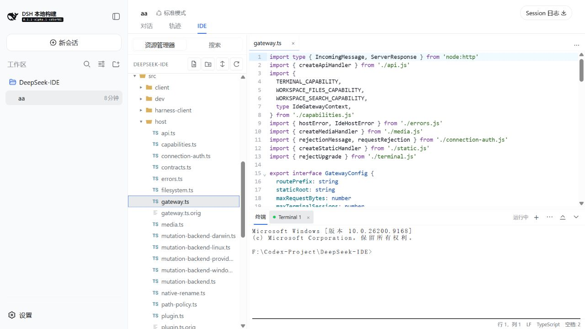
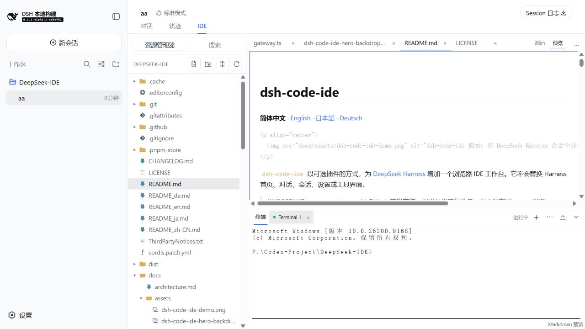
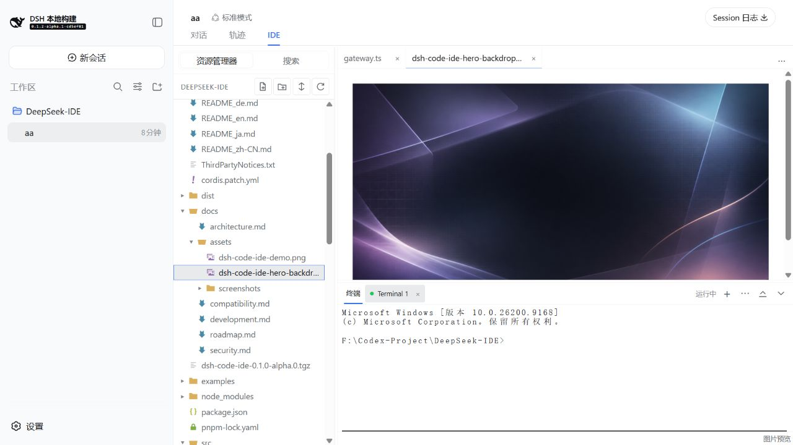
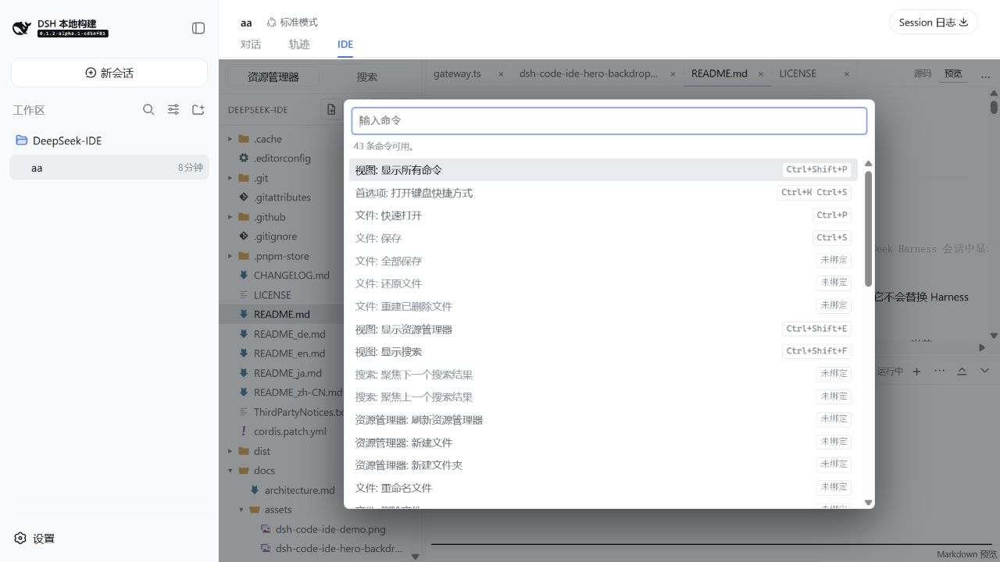

# dsh-code-ide

  <strong>在 DeepSeek Harness 会话里，打开一个轻量、熟悉的浏览器 IDE。</strong>

  简体中文 · <a href="README_en.md">English</a> · <a href="README_ja.md">日本語</a> · <a href="README_de.md">Deutsch</a>

  

`dsh-code-ide` 为 [DeepSeek Harness](https://github.com/deepseek-ai/deepseek-harness) 增加一个可选的 **IDE** 页签：写代码、搜索工作区、在终端运行命令，以及预览 Markdown 和媒体文件。它不接管 Harness 的首页、对话或会话；随时切回 **对话** 即可继续原来的工作。

  

## 30 秒安装

已有 `dsh` 时，只需运行：

~~~sh
dsh plugin --profile web add github:SakalioLabs/dsh-code-ide
dsh web
~~~

如果你是从 Harness 源码目录运行，把上面的 `dsh` 换成 `pnpm dsh`。无需 clone 本仓库、无需手工复制 patch，也不需要为本插件配置 `allowBuilds`。

也可以把这句话直接交给 Harness：

~~~text
安装 github:SakalioLabs/dsh-code-ide 到当前 Web profile，然后重启 Harness。
~~~

## 第一次使用

1. 启动 `dsh web`，在浏览器中打开终端打印的地址。
2. 新建或打开一个已关联工作区的会话；没有工作区时，先从 Harness 添加本地工作区。
3. 点击会话顶部的 **IDE**，打开文件开始工作；要继续聊天时切回 **对话**。

## 你会得到什么

| 写与读 | 查与跑 |
| --- | --- |
| 主流语言按需高亮；多标签、拖拽排序、最多 4 个编辑器分组；版本感知保存与恢复。 | 资源管理器、Quick Open、工作区搜索/替换预览、命令面板和多终端底部面板。 |
| Markdown 可在源码与安全预览间切换；图片、音频和视频使用只读原生预览。 | 轻量集成：不携带 VS Code Extension Host、Marketplace 或 VSIX 兼容层。 |

## 真实功能演示

### Markdown：边写边预览

`.md`、`.markdown` 与 `.mdx` 支持源码/预览切换；预览反映当前编辑缓冲区，不执行 raw HTML 或 MDX。

### 图片、音频和视频：直接查看，不误编辑二进制

常见图片可直接预览；音频和视频使用浏览器原生控件、按需流式读取且不会自动播放。

### 命令面板：少记一点，直接找功能

用 `Ctrl+Shift+P` / `F1` 打开命令面板；常用的 Quick Open、搜索、保存、终端和布局操作都可从这里发现。

## 兼容与边界

- 当前主线同时维护新 Harness 的 Connection 鉴权接口与旧版 loopback 鉴权回退，避免为了跟进新版而破坏既有安装。
- 已测试目标包括 `dsh-v0.1.2-alpha.1` 和 `dsh-v0.1.1-rc.2`；精确版本、平台能力与验证范围见 [兼容性文档](docs/compatibility.md)。
- 插件是浏览器 IDE 工作台，不是 VS Code，也不支持 VS Code 插件、VSIX、Marketplace、LSP、调试器或 Git UI。
- 终端以运行 Harness 的本机用户权限执行。仅在可信的本机 loopback 环境使用，不要暴露到局域网或互联网。

## 需要更多细节？

- [兼容性与平台能力](docs/compatibility.md)
- [安全边界](docs/security.md)
- [开发、构建与测试](docs/development.md)
- [架构说明](docs/architecture.md)
- [更新记录](CHANGELOG.md)

## 许可证

[MIT License](LICENSE)。Seti 风格文件图标的归属和固定来源见 [ThirdPartyNotices.txt](ThirdPartyNotices.txt)。
