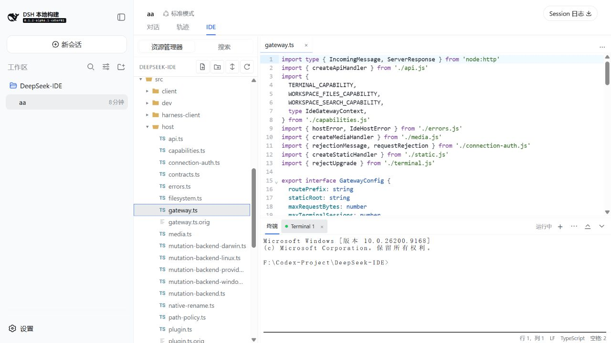
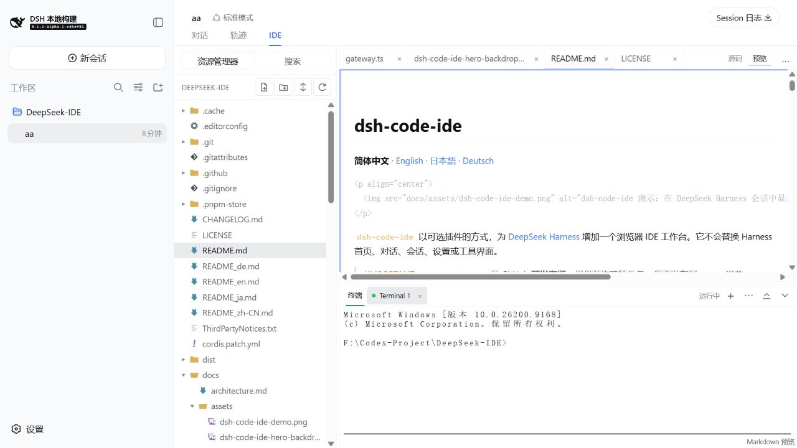
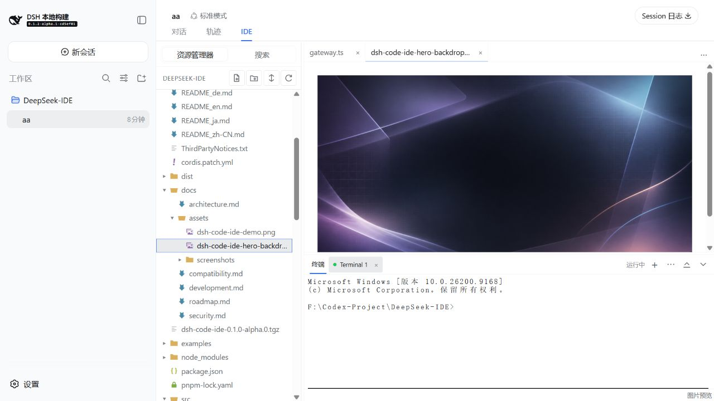
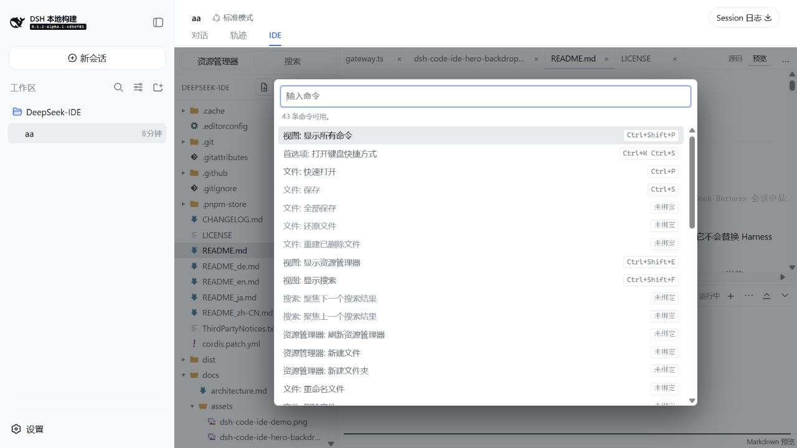
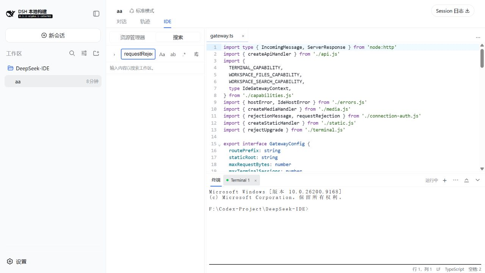

# dsh-code-ide

[简体中文](README_zh-CN.md) | [English](README_en.md) | [日本語](README_ja.md) | **Deutsch**

**Ein ruhiger, leistungsfähiger Arbeitsbereich für Code direkt in DeepSeek Harness.** `dsh-code-ide` ergänzt eine Harness-Sitzung um einen optionalen **IDE**-Reiter. So bleiben Dateibrowser, Syntax-Highlighting, Terminal, Suche, geteilte Editoren sowie Dokument- und Medienvorschau direkt bei der Unterhaltung.

<p align="center">
  
</p>

<p align="center">
  
</p>

## In 30 Sekunden installieren

```sh
dsh plugin --profile web add github:SakalioLabs/dsh-code-ide
dsh web
```

Wenn Harness aus einem Source-Checkout läuft, ersetze `dsh` durch `pnpm dsh`.

Du kannst Harness auch einfach diese eine Zeile schicken:

> Installiere `github:SakalioLabs/dsh-code-ide` in meinem `web`-Profil und starte Web anschließend neu.

## Erste Schritte

1. In Harness einen Arbeitsbereich öffnen oder hinzufügen und eine Sitzung dafür erstellen bzw. auswählen.
2. Den **IDE**-Reiter dieser Sitzung auswählen.
3. Im Explorer eine Datei öffnen und direkt bearbeiten, suchen, anzeigen oder das Terminal verwenden.

## Für den täglichen Ablauf

- **Angenehm schreiben** — CodeMirror-Editor mit Sprach-Highlighting, Dateisymbolen, Tabs, Speicherstatus und vertrauten Tastenkürzeln.
- **Kontext im Blick behalten** — Tabs umsortieren, einen Editor nach oben oder rechts teilen (bis zu vier Gruppen) und das Terminal unten angedockt lassen.
- **Sicher finden und ändern** — Die Arbeitsbereichssuche bietet Filter und einen Ersetzungsablauf mit Vorschau vor der Anwendung.
- **Ergebnisse direkt ansehen** — Markdown erhält eine sichere Live-Vorschau; gängige Bilder, Audio- und Videodateien öffnen schreibgeschützt im Browser.

## Reale Ansichten

<p align="center">
  
  
</p>

<p align="center">
  <em>Markdown bleibt mit dem aktuellen Puffer synchron; Bilder, Audio und Video erhalten aufgeräumte schreibgeschützte Vorschauen.</em>
</p>

<p align="center">
  
  
</p>

<p align="center">
  <em>Über die Befehlspalette lassen sich Aktionen finden; die Arbeitsbereichssuche beschleunigt die Orientierung im Repository.</em>
</p>

## Kompatibilität und Umfang

Die aktive Integration folgt der aktuellen Harness-Alpha-Linie; für die gepflegte Linie `0.1.1-rc.2` bleibt eine abgesicherte Fallback-Verbindung erhalten. Prüfe vor einem fest gepinnten Einsatz den genauen Geltungsbereich in [Compatibility](docs/compatibility.md).

Die Arbeitsoberfläche orientiert sich an hilfreichen VS-Code-Konventionen, ist aber **nicht VS Code**. Sie lädt keine VS-Code-Erweiterungen, Marketplace-Pakete, Erweiterungshosts, LSP-Server oder Debugger.

Zu Betriebsgrenzen, Sicherheit des Arbeitsbereichs und Entwicklung: [Compatibility](docs/compatibility.md), [Security](docs/security.md), [Development](docs/development.md) und [Changelog](CHANGELOG.md).

## Lizenz

[MIT](LICENSE) © 2026 SakalioLabs. Hinweise zu den Seti-UI-Dateisymbolen stehen in [ThirdPartyNotices.txt](ThirdPartyNotices.txt).
