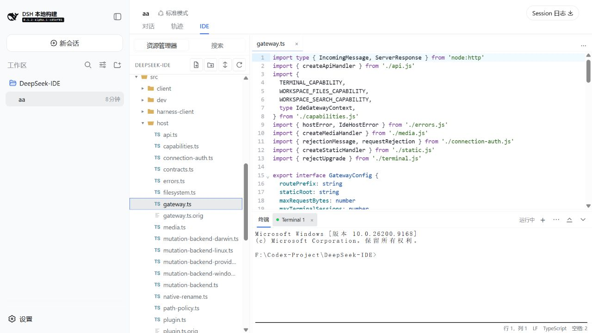
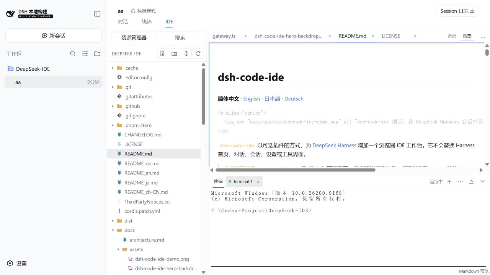
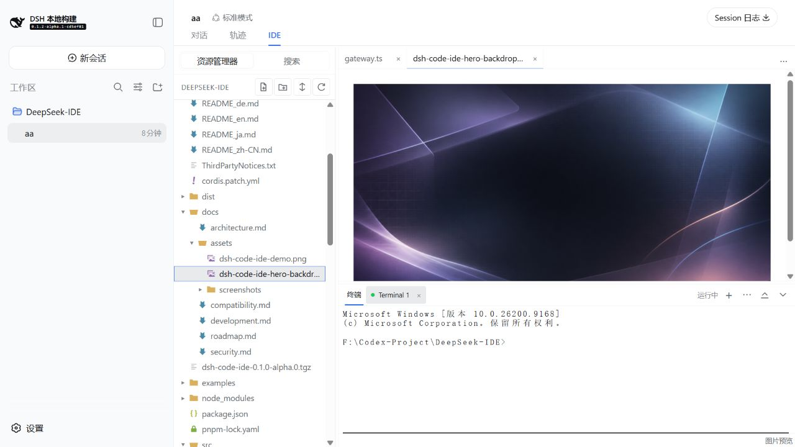
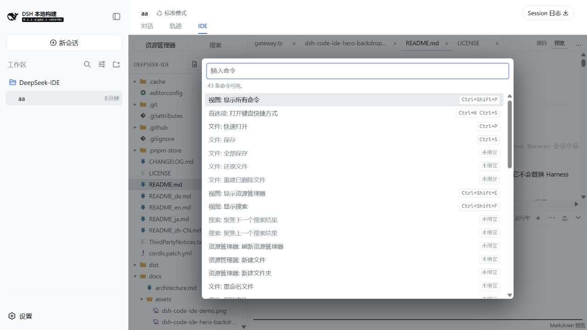
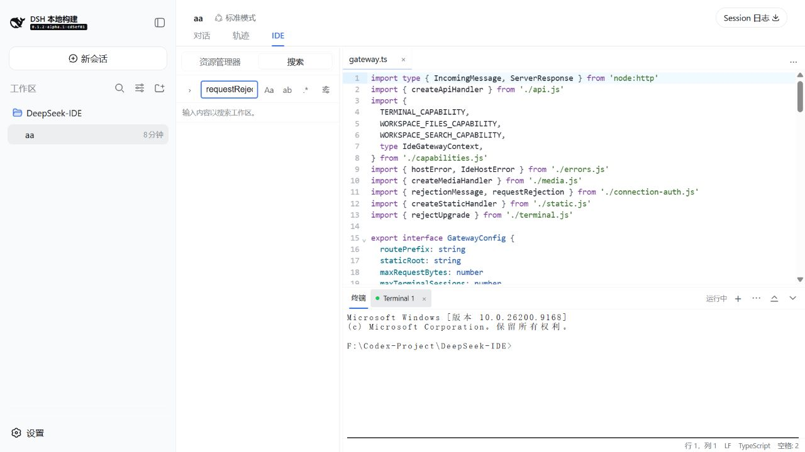

# dsh-code-ide

[简体中文](README_zh-CN.md) | **English** | [日本語](README_ja.md) | [Deutsch](README_de.md)

**A calm, capable code workspace inside DeepSeek Harness.** `dsh-code-ide` adds an optional **IDE** tab to a Harness session, so you can browse a workspace, edit highlighted source, run a terminal, search, split editors, and preview documents or media without leaving the conversation.

<p align="center">
  
</p>

<p align="center">
  
</p>

## Install in 30 seconds

```sh
dsh plugin --profile web add github:SakalioLabs/dsh-code-ide
dsh web
```

If you run Harness from a source checkout, use `pnpm dsh` in place of `dsh`.

Prefer asking Harness to do it? Send this one line:

> Install `github:SakalioLabs/dsh-code-ide` into my `web` profile, then restart Web.

## First use

1. Open or add a workspace in Harness, then create or select a session for it.
2. Choose the session's **IDE** tab.
3. Open a file from Explorer and start editing, searching, previewing, or using the terminal.

## Built for the everyday loop

- **Write code comfortably** — CodeMirror editing with language highlighting, file icons, tabs, saved state, and familiar shortcuts.
- **Keep context visible** — reorder tabs, split an editor to the top or right (up to four groups), and keep a terminal docked below.
- **Find and change with confidence** — workspace search supports filters and a preview-first replacement flow.
- **See the result in place** — Markdown uses a safe live preview; common images, audio, and video open as read-only browser previews.

## A few real screens

<p align="center">
  
  
</p>

<p align="center">
  <em>Markdown stays in sync with the working buffer; image, audio, and video files use focused read-only previews.</em>
</p>

<p align="center">
  
  
</p>

<p align="center">
  <em>Use the Command Palette for actions and workspace search to move through a repository quickly.</em>
</p>

## Compatibility and scope

The active integration follows the latest Harness alpha line, while a guarded connection fallback is retained for the maintained `0.1.1-rc.2` line. For pinned environments and the exact support boundary, read [Compatibility](docs/compatibility.md) before installing.

The workbench follows useful VS Code interaction patterns, but it is **not VS Code** and does not load VS Code extensions, Marketplace packages, an extension host, LSP servers, or a debugger.

For operational limits, workspace safety, and development details, see [Compatibility](docs/compatibility.md), [Security](docs/security.md), [Development](docs/development.md), and the [changelog](CHANGELOG.md).

## License

[MIT](LICENSE) © 2026 SakalioLabs. Seti UI file-icon attribution is in [ThirdPartyNotices.txt](ThirdPartyNotices.txt).
