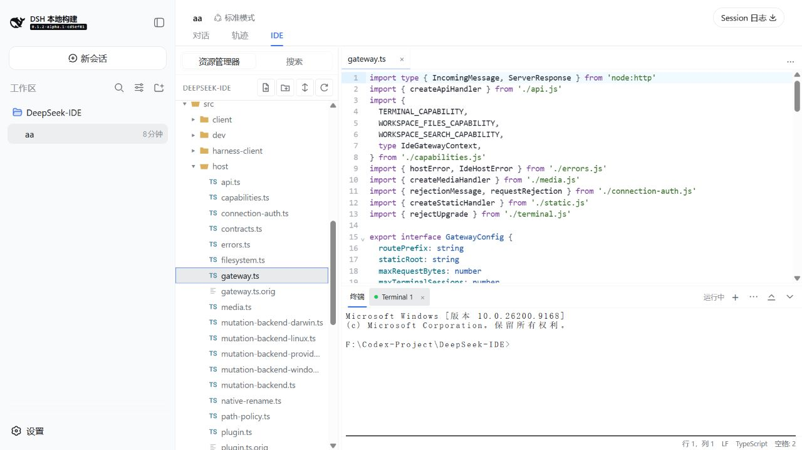
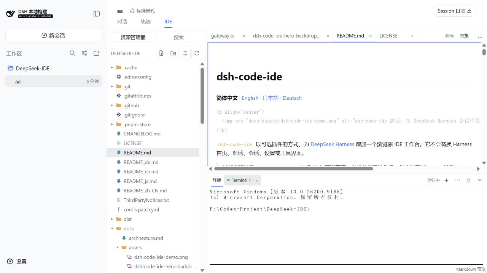
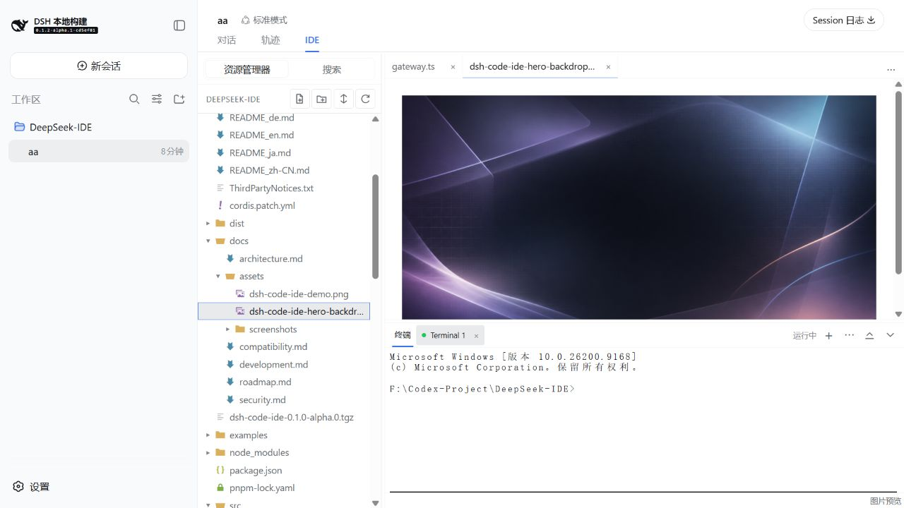
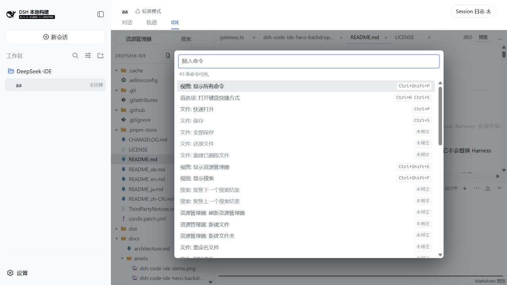
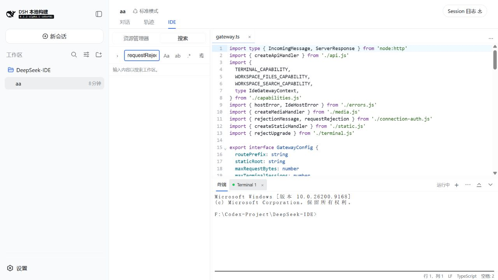

# dsh-code-ide

[简体中文](README_zh-CN.md) | [English](README_en.md) | **日本語** | [Deutsch](README_de.md)

**DeepSeek Harness の会話に、落ち着いて使えるコード作業空間を。** `dsh-code-ide` は Harness のセッションに任意の **IDE** タブを追加します。会話を離れずに、ワークスペースの閲覧、シンタックスハイライト付き編集、ターミナル、検索、分割表示、ドキュメントとメディアのプレビューができます。

<p align="center">
  
</p>

<p align="center">
  
</p>

## 30 秒でインストール

```sh
dsh plugin --profile web add github:SakalioLabs/dsh-code-ide
dsh web
```

Harness をソース checkout から実行している場合は、`dsh` の代わりに `pnpm dsh` を使用してください。

Harness に任せる場合は、この一文を送れます。

> `github:SakalioLabs/dsh-code-ide` を私の `web` profile にインストールして、Web を再起動してください。

## 最初の使い方

1. Harness でワークスペースを開くか追加し、そのワークスペースのセッションを作成または選択します。
2. セッションの **IDE** タブを選択します。
3. Explorer からファイルを開き、編集、検索、プレビュー、またはターミナルを始めます。

## 日々の作業のために

- **気持ちよく書く** — CodeMirror の編集、言語ハイライト、ファイルアイコン、タブ、保存状態、なじみのショートカット。
- **文脈を保つ** — タブを並べ替え、エディターを上または右へ分割（最大 4 グループ）し、下部のターミナルを表示したままにできます。
- **安心して見つけて変更する** — ワークスペース検索はフィルターと、適用前に確認できる置換フローを提供します。
- **結果をその場で確認する** — Markdown は安全なライブプレビューに対応し、一般的な画像・音声・動画は読み取り専用で開けます。

## 実際の画面

<p align="center">
  
  
</p>

<p align="center">
  <em>Markdown は作業中のバッファーと同期し、画像・音声・動画は見やすい読み取り専用プレビューで表示されます。</em>
</p>

<p align="center">
  
  
</p>

<p align="center">
  <em>コマンドパレットで操作を見つけ、ワークスペース検索でリポジトリ内を素早く移動できます。</em>
</p>

## 互換性と対象範囲

現在の統合は最新の Harness alpha 系を対象に進めつつ、保守対象の `0.1.1-rc.2` 系には接続層のガード付きフォールバックを残しています。固定環境で使う前に、正確な対象範囲を [Compatibility](docs/compatibility.md) で確認してください。

操作感は VS Code の便利なパターンを参考にしていますが、これは **VS Code ではありません**。VS Code 拡張機能、Marketplace パッケージ、拡張ホスト、LSP サーバー、デバッガーは読み込みません。

運用上の制限、ワークスペースの安全性、開発情報は [Compatibility](docs/compatibility.md)、[Security](docs/security.md)、[Development](docs/development.md)、[変更履歴](CHANGELOG.md) を参照してください。

## ライセンス

[MIT](LICENSE) © 2026 SakalioLabs。Seti UI ファイルアイコンの帰属表示は [ThirdPartyNotices.txt](ThirdPartyNotices.txt) にあります。
